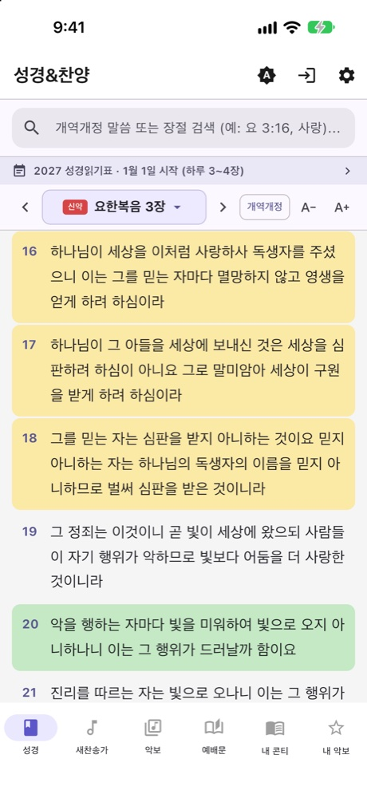
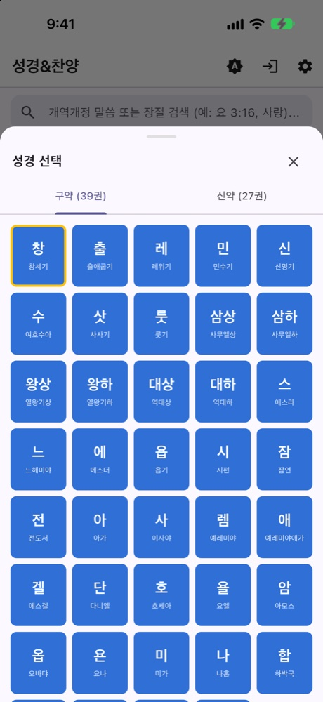
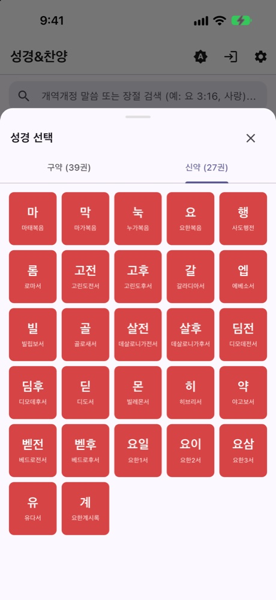
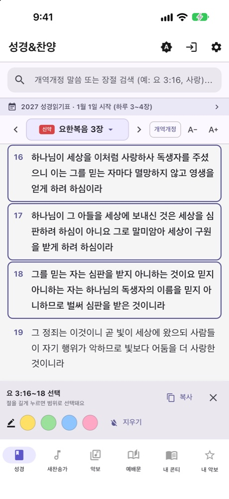
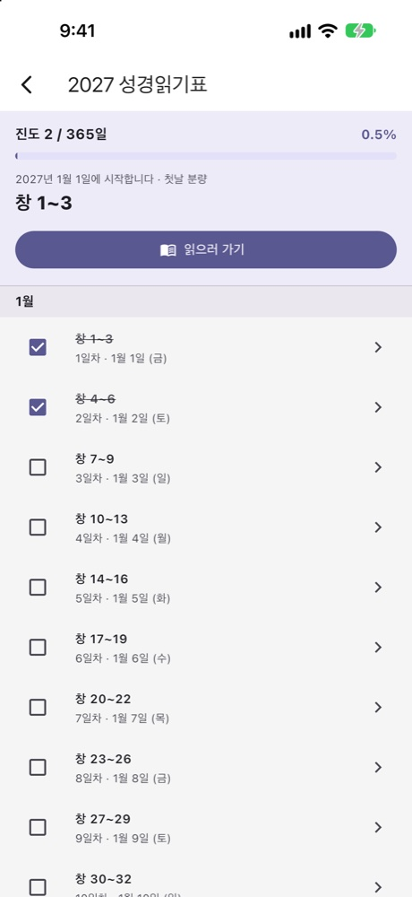
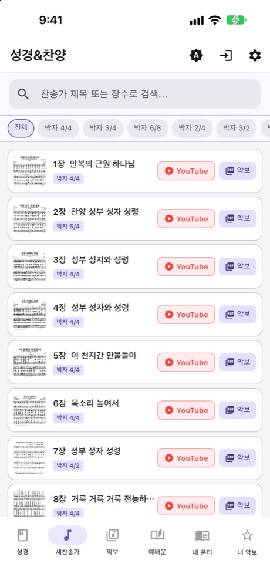
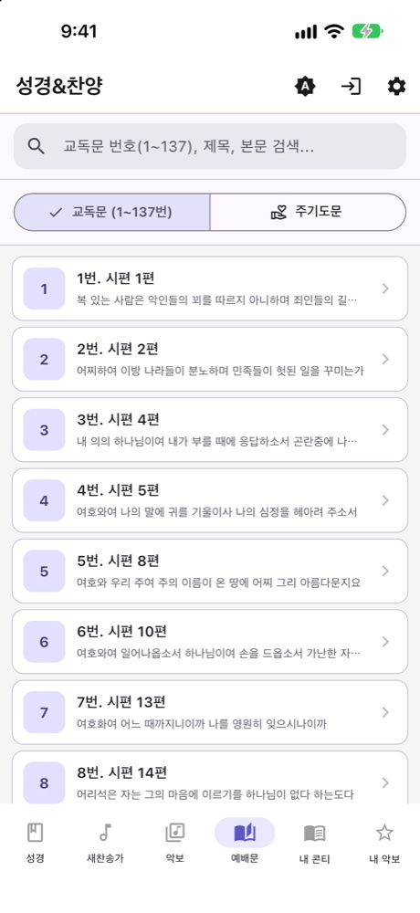

# 📖 성경&찬양 (구 교회찬양집) — 성경 · 새찬송가 & CCM 악보 뷰어 앱
> **개발 기간:** 2026.06 ~ 진행중 (개인 프로젝트, 1인 개발)  
> **플랫폼:** Android (Google Play Store 배포) / iOS  
> **패키지명:** com.terablack.churchpraise  
> **현재 버전:** 1.4.0 (빌드 13)  
> **저장소:** [github.com/herjy6372/churchpraise-app](https://github.com/herjy6372/churchpraise-app)

---

| 성경 · 형광펜 | 성경 선택 (구약) | 성경 선택 (신약) | 여러 절 선택 |
|:---:|:---:|:---:|:---:|
|  |  |  |  |
| **2027 성경읽기표** | **새찬송가** | **예배문** | |
|  |  |  | |

---

## 💡 1. 프로젝트 소개

교회 예배 및 찬양팀을 위한 **디지털 악보 뷰어 앱**입니다.  
기존에 종이 악보집이나 여러 앱을 번갈아 사용하던 불편함을 해소하고자,  
**새찬송가 645곡 + CCM** 악보를 하나의 앱에서 통합 관리할 수 있도록 제작했습니다.

악보 열람, 유튜브 연동, 필기 기능, 콘티(세트리스트) 관리, 즐겨찾기, 클라우드 동기화까지  
예배 준비에 필요한 기능을 모두 담았습니다.

---

## 🛠 2. 사용 기술 및 개발 환경 (Tech Stack)

| 분류 | 기술 |
|------|------|
| **언어** | Dart |
| **프레임워크** | Flutter 3.x |
| **상태 관리** | ValueNotifier, setState |
| **로컬 저장** | SharedPreferences |
| **PDF 렌더링** | pdfx |
| **인증** | Firebase Auth, Google Sign-In v7 |
| **데이터베이스** | Cloud Firestore |
| **네트워크** | http, url_launcher |
| **배포 (Android)** | Google Play Store (AAB, Release Signing) |
| **배포 (iOS)** | TestFlight / App Store |
| **버전 관리** | Git |
| **개발 환경** | macOS, VS Code, Android Studio |

---

## 🌟 3. 핵심 기능 및 구현 내용

### 🔑 주요 기능

- **악보 뷰어**
  - PDF를 렌더링하여 전체화면으로 악보 열람
  - 핀치줌 / 스크롤 지원 (InteractiveViewer)
  - 좌우 버튼으로 이전/다음 악보 이동
  - 툴바 위치(상단/하단) 사용자 설정 저장

- **필기 기능**
  - 펜 / 형광펜 / 지우개 도구 지원
  - 색상 및 굵기 조절
  - 실행 취소(Undo) / 다시 실행(Redo)
  - JSON 직렬화로 필기 데이터 로컬 영구 저장

- **새찬송가 (645곡)**
  - 번호·제목 검색
  - 박자(4/4, 3/4, 6/8 등) 태그 필터
  - 유튜브 링크 연동 (곡별 유튜브 버튼)

- **CCM**
  - 동일 곡명의 다중 키(A, Bb, C…)를 ExpansionTile로 그룹핑
  - 이름순 정렬
  - 박자 태그 필터

- **콘티(세트리스트) 관리**
  - 찬양 목록을 순서대로 묶어 콘티 생성·편집·삭제
  - 콘티 시작 시 악보 뷰어가 순서대로 연속 재생

- **즐겨찾기 (내 악보)**
  - 별표로 즐겨찾기 등록·해제
  - 등록 날짜 기준 정렬 표시

- **Google 로그인 & 클라우드 동기화**
  - Firebase Auth + Google Sign-In으로 로그인
  - 즐겨찾기·콘티·태그·필기 데이터를 Firestore에 백업/복원
  - 마지막 백업 시각 표시

- **설정**
  - 라이트/다크/시스템 테마 전환
  - 앱 버전 표시 + Play Store 최신 버전 자동 비교
  - 개인정보처리방침 연동 (GitHub Pages)

---

## 🪵 4. 아키텍처 및 시스템 구조

> 아래는 첫 출시(v1.0) 당시 구조입니다. 최신 구조는 **8-6) 저장소 구조 (v1.3.0 기준)**와 **9-5) 추가·변경된 파일 (v1.4.0)**을 참고하세요.

```
lib/ (v1.0 기준)
├── main.dart                  # 앱 진입점, Firebase 초기화
├── models/
│   ├── song.dart              # 악보 모델 (찬송가·CCM 공통)
│   └── conti.dart             # 콘티 모델
├── data/
│   ├── hymn_data.dart         # 새찬송가 645곡 제목·유튜브URL·박자 정적 데이터
│   └── ccm_data.dart          # CCM 곡 데이터
├── services/
│   ├── favorites_service.dart # 즐겨찾기 CRUD (SharedPreferences)
│   ├── conti_service.dart     # 콘티 CRUD (SharedPreferences)
│   ├── tag_service.dart       # 박자 태그 관리 + 마이그레이션 (V1~V8)
│   ├── sync_service.dart      # Google 로그인 + Firestore 백업/복원
│   └── app_settings.dart      # 테마 설정
├── screens/
│   ├── home_screen.dart       # 메인 화면 (새찬송가·CCM·콘티·내악보 탭)
│   ├── viewer_screen.dart     # PDF 뷰어 + 필기 도구
│   ├── settings_screen.dart   # 설정 화면
│   └── conti_editor_screen.dart
└── widgets/
    ├── filter_sheet.dart
    └── tag_editor_sheet.dart
```

- **데이터 흐름:** 정적 데이터(hymn_data) → Service 레이어(SharedPreferences/Firestore) → UI (ValueNotifier로 반응형 갱신)
- **태그 시스템:** 마이그레이션 버전(V1~V8) 방식으로 앱 업데이트 시 기존 사용자 데이터 무결성 유지
- **박자 자동 동기화:** `HymnData.timeSignatures` 맵 항목 수 변화를 감지해 마이그레이션 버전 업 없이 자동 반영

---

## 🔥 5. 트러블 슈팅 (Troubleshooting)

### ① 릴리즈 빌드에서 Google 로그인 실패

#### ❌ 문제 상황
- 디버그 빌드에서는 Google 로그인이 정상 동작했으나, Play Store에서 다운로드한 릴리즈 빌드에서 `clientConfigurationError` 및 `Account reauth failed` 오류 발생

#### 🔍 원인 및 해결
- Play Store는 APK/AAB를 **자체 키로 재서명(App Signing)** 하여 배포하므로, 개발용 Keystore의 SHA-1과 실제 배포 빌드의 SHA-1이 달라짐
- Play Console → 앱 서명 페이지에서 **Play Store App Signing SHA-1** 확인 후 Firebase 콘솔에 추가
- 새 `google-services.json` 다운로드 후 재빌드로 해결

---

### ② iOS PDF 스크롤 불가 문제

#### ❌ 문제 상황
- Android에서는 긴 악보를 아래로 스크롤할 수 있었으나, iOS에서는 스크롤이 전혀 되지 않음

#### 🔍 원인 및 해결
- `InteractiveViewer`의 `boundaryMargin`이 고정값으로 설정되어 있어, 실제 PDF 높이보다 작을 경우 스크롤 영역이 제한됨
- PDF 실제 렌더링 높이를 계산하여 `boundaryMargin`을 동적으로 설정하여 해결

```dart
final scaledH = _totalH * (MediaQuery.of(context).size.width / _pageW);
final verticalMargin = (scaledH > screenH) ? scaledH : screenH;
boundaryMargin: EdgeInsets.symmetric(horizontal: 80, vertical: verticalMargin),
```

---

### ③ 박자 태그가 앱 업데이트 후 반영되지 않는 문제

#### ❌ 문제 상황
- 새찬송가 1~104장 박자 태그를 추가했음에도 기존 사용자의 기기에서는 박자 태그가 표시되지 않음

#### 🔍 원인 및 해결
- `TagService`의 마이그레이션 버전을 올리지 않으면 기존 사용자에게 새 태그가 적용되지 않는 구조
- 매번 마이그레이션 버전을 올리는 대신, `HymnData.timeSignatures`의 항목 수를 감지해 자동 동기화하는 `_syncTimeSignatures()` 메서드를 도입

```dart
// 항목 수가 바뀌면 자동 재동기화 → 마이그레이션 버전 불필요
if (lastCount != HymnData.timeSignatures.length) {
  await _syncTimeSignatures(prefs, tags);
}
```

---

### ④ google_sign_in v7 API 변경 대응

#### ❌ 문제 상황
- `google_sign_in` 패키지를 최신 버전(v7)으로 업그레이드 후 `GoogleSignIn()` 생성자 및 `accessToken` API가 제거되어 빌드 실패

#### 🔍 원인 및 해결
- v7에서 싱글턴 방식(`GoogleSignIn.instance.initialize()`)으로 API가 변경됨
- `accessToken` 대신 `idToken`만으로 Firebase 인증 처리하도록 수정

```dart
// v7 방식
GoogleSignIn.instance.initialize(
  clientId: '...',
  serverClientId: '...',
);
final googleUser = await GoogleSignIn.instance.authenticate();
final credential = GoogleAuthProvider.credential(
  idToken: googleUser.authentication.idToken,
);
```

---

## 📈 6. 성과 및 회고

- Google Play Store 정식 출시 (버전 1.0.0 → 1.0.4)
- 새찬송가 645곡 전곡 + CCM 다수 악보·유튜브·박자 데이터 직접 구축
- Firebase 클라우드 동기화로 기기 교체 시에도 데이터 유지 가능
- 필기 기능(펜·형광펜·지우개·Undo/Redo)을 CustomPainter로 직접 구현하여 별도 외부 패키지 의존 없이 처리
- Android/iOS 크로스플랫폼 단일 코드베이스로 유지보수 효율 극대화
- 추후 계획: 조성 필터, 악보 검색 고도화, iOS App Store 출시

---

## 🚀 7. 추가 작업 및 업데이트 내역 (v1.0.4 → v1.2.0+11)

### 📌 1) 앱 구성 확장 및 네비게이션 개편
- 기존 4개 탭(`새찬송가 · CCM · 내 콘티 · 내 악보`)에서 **6개 탭(`성경 · 새찬송가 · 악보 · 예배문 · 내 콘티 · 내 악보`)** 구조로 확장하여 예배 전반에 활용할 수 있는 통합 예배 앱으로 고도화
- 각 탭의 성격에 맞춰 검색창 힌트 문구 및 박자 필터 바 노출 여부를 동적으로 전환하도록 UX 개선
- `flutter_launcher_icons` 도입으로 Android Adaptive Icon(`#252560` 배경 + 전경 분리) 및 iOS 전용 앱 아이콘 일괄 적용

### 📖 2) 개역개정 성경(구약 39권 · 신약 27권) 열람 및 통합 검색 기능 추가
- **오프라인 성경 데이터 탑재 및 백그라운드 파싱 (`BibleService`)**
  - `assets/bible/ko_rev.json` 데이터를 내장하여 네트워크 연결 없이도 성경 66권 전권 열람 가능
  - 대용량 JSON 로드 시 UI 프레임 드롭을 방지하기 위해 `compute()`(Isolate)를 활용한 비동기 파싱 처리
- **성경 리더 뷰 (`BibleTab`)**
  - 구약(39권) / 신약(27권) 탭 분리 그리드 및 장 선택 모달 바텀 시트(`_BiblePickerSheet`) 구현
  - 이전 장 / 다음 장 이동 버튼 (권의 첫 장/마지막 장에서 이전·다음 권으로 자동 연결)
  - 본문 내 `<소제목>` 패턴을 정규식으로 분리 파싱하여 상단 뱃지 형태로 시각화
  - 절 터치 시 하이라이트 토글, 길게 누르기(Long Press) 시 클립보드에 말씀 구절 복사 지원
  - 글자 크기 조절(13pt ~ 32pt) 및 마지막으로 읽던 성경 권·장·글자 크기 `SharedPreferences` 자동 저장/복원
- **장·절 참조 및 키워드 통합 검색**
  - 정규식 기반 장·절 참조 검색(예: `"요 3:16"`, `"요한복음 3장 16절"`, `"시편 23"`)과 본문 키워드 검색(예: `"사랑"`)을 하나의 검색창에서 동시 지원
  - 검색 결과 터치 시 해당 장 전체 보기 화면(`_BibleChapterDetailScreen`)으로 이동하며 검색된 절을 자동 하이라이트 표시

### 🙏 3) 예배문 탭 신설 (교독문 1~137번 전편 & 주기도문)
- **교독문 전체 데이터 구축 (`ResponsiveReadingData`)**
  - 21세기 찬송가 교독문 1번~137번 전편 수록 및 번호·제목·본문 키워드 실시간 검색 지원
  - 구절별 낭독 주체(`인도자`, `회중`, `다같이`) 모델링(`ReadingRole`)
- **교독문 상세 화면 (`ResponsiveReadingDetailScreen`)**
  - 상단 범례 바 제공 및 역할별 뱃지·카드 배경색·글자 굵기 차별화로 예배 중 가독성 극대화
  - 글자 크기 실시간 확대/축소(13pt ~ 30pt) 및 이전/다음 교독문 즉시 이동 버튼 지원
- **주기도문 뷰**
  - 상단 `SegmentedButton`으로 `교독문 (1~137번)`과 `주기도문 (개역개정)` 화면 전환 및 글자 크기 조절 지원

### 🎼 4) 사용자 직접 업로드 악보(PDF / 이미지) 관리 시스템 구축
- **정적 CCM 탭 → 사용자 맞춤형 '악보' 탭으로 개편 (`ScoreService`)**
  - 내장 CCM 데이터(`ccm_data.dart`)를 제거하고, 사용자가 기기에 보유한 **PDF 또는 이미지(JPG, PNG 등) 악보 파일**을 직접 등록·관리할 수 있도록 구조 변경
- **외부 패키지 없이 MethodChannel 기반 Android / iOS 네이티브 파일 피커 직접 구현**
  - 채널명: `com.terablack.churchpraise/file_picker` (`pickScoreFile`, `getScoresDir`)
  - **Android (`MainActivity.kt`)**: `Intent.ACTION_OPEN_DOCUMENT`로 PDF(`application/pdf`) 및 이미지(`image/*`) 선택 후 앱 내부 저장소(`filesDir/custom_scores`)로 스트림 복사
  - **iOS (`AppDelegate.swift`)**: `UIDocumentPickerViewController`(`UTType.pdf`, `UTType.image`)로 파일 선택 후 앱 샌드박스 `Documents/custom_scores` 폴더로 안전하게 복사
- **로컬 PDF·이미지 통합 뷰어 및 썸네일 렌더링 (`ViewerScreen`, `_PdfThumb`)**
  - `Song` 모델에 `isLocalFile`, `isPdf` 속성을 추가하여 에셋 PDF(`PdfDocument.openAsset`), 로컬 PDF(`PdfDocument.openFile`), 로컬 이미지(`ui.instantiateImageCodec`)를 단일 뷰어와 썸네일 위젯에서 통합 렌더링
  - 업로드한 개인 악보에도 기존과 동일하게 **펜/형광펜/지우개 필기 저장, 박자 및 커스텀 태그 편집, 제목 수정, 파일 삭제, 내 악보(즐겨찾기) 등록, 콘티(`ContiEditorScreen`) 추가** 기능 완벽 호환

### 🎵 5) 새찬송가 645곡 데이터 완비 및 아키텍처 업데이트
- 새찬송가 1장~645장 전곡의 박자(`timeSignatures`) 및 유튜브 링크(`youtubeUrls`) 매핑 완료 (`12/8` 등 박자 추가)
- `TagService` 마이그레이션 V9 확장 및 박자 자동 동기화 연동

```
lib/ (v1.2.0 기준 추가·변경된 구조)
├── main.dart                          # 앱 진입점, 서비스 초기화 (ScoreService 등 추가)
├── models/
│   ├── song.dart                      # 악보 모델 (isLocalFile, isPdf 속성 확장)
│   └── conti.dart                     # 콘티 모델
├── data/
│   ├── hymn_data.dart                 # 새찬송가 645곡 전곡 제목·유튜브URL·박자 데이터
│   ├── responsive_reading_data.dart   # [신규] 교독문 1~137번 & 주기도문 정적 데이터
│   └── tag_definitions.dart           # 태그 카테고리 정의
├── services/
│   ├── bible_service.dart             # [신규] 개역개정 성경 66권 Isolate 로드 & 장절/본문 검색
│   ├── score_service.dart             # [신규] 네이티브 파일 피커 연동 & 사용자 악보 CRUD
│   ├── favorites_service.dart         # 즐겨찾기 CRUD (찬송가 h_* 및 업로드 악보 s_* 호환)
│   ├── conti_service.dart             # 콘티 CRUD
│   ├── tag_service.dart               # 박자 태그 관리 + 마이그레이션 (V1~V9) 및 자동 동기화
│   ├── sync_service.dart              # Google 로그인 + Firestore 백업/복원
│   └── app_settings.dart              # 테마 설정
├── screens/
│   ├── home_screen.dart               # 6탭 메인 화면 (성경·새찬송가·악보·예배문·내콘티·내악보)
│   ├── bible_tab.dart                 # [신규] 성경 열람, 권/장 피커 시트, 하이라이트/복사, 검색 뷰
│   ├── responsive_reading_screen.dart # [신규] 교독문 상세 화면 (역할별 구분, 글자 크기 조절)
│   ├── viewer_screen.dart             # PDF + 로컬 이미지 통합 악보 뷰어 & 필기 도구
│   ├── conti_editor_screen.dart       # 콘티 편집기 (새찬송가 + 업로드 악보 선택 시트)
│   └── settings_screen.dart           # 설정 화면
└── widgets/
    ├── filter_sheet.dart
    └── tag_editor_sheet.dart
```

---

## 🆕 8. v1.3.0 업데이트 (빌드 12)

### 🏷 1) 앱 이름 변경 및 새 앱 아이콘
- 성경·새찬송가·예배문까지 아우르는 앱 성격에 맞춰 앱 이름을 **`교회찬양집` → `성경&찬양`**으로 변경 (홈 화면, 앱 상단 제목, 설정 화면)
- 패키지명(`com.terablack.churchpraise`)은 유지하여 기존 사용자에게 같은 앱의 업데이트로 배포
- 초록색 성경 디자인의 새 앱 아이콘 적용 — iOS 전 사이즈 및 Android Adaptive Icon(흰색 배경)을 `flutter_launcher_icons`로 일괄 생성하고, 원형·스쿼클 마스크에서 잘리지 않도록 여백 조정

### 📖 2) 성경 역본 선택 (개역개정 · 개역한글 · KJV)
- 성경 탭 상단 역본 버튼으로 **개역개정(기본) · 개역한글 · KJV** 전환, 선택한 역본은 `SharedPreferences`에 저장해 재실행 시 유지
- `BibleVersion` enum으로 역본별 에셋을 관리하고, 전환 시 `compute()` Isolate 파싱으로 UI 멈춤 없이 교체
- 역본과 관계없이 책 이름은 한글로 통일해 권/장 피커와 장절 검색을 같은 방식으로 사용
- 공개 역본 원본 JSON을 앱 형식으로 바꾸는 변환 스크립트(`tool/convert_bible.py`) 작성

### 🔍 3) 역본별 검색 분리
- 장절·본문 검색이 **현재 선택한 역본 안에서만** 동작하도록 정리 (다른 역본 본문이 섞여 나오지 않음)
- KJV에서는 `John 3:16`, `Jn 3:16`, `1 John 4:8`, `Ps 23` 같은 영어 책 이름·약어 장절 검색과 `love` 같은 영어 본문 검색 지원
- 검색창 안내 문구를 역본에 맞게 변경 (예: KJV 선택 시 `John 3:16, love`)
- `요 3:16` 검색 시 `요엘·요나·요한1서` 등 "요"로 시작하는 책까지 함께 나오던 문제를 약어 정확 일치 우선으로 수정

### ✅ 4) 테스트
- 역본별 장절·본문 검색과 역본 간 결과 분리를 검증하는 단위 테스트(`test/bible_search_test.dart`) 추가 — 전체 12개 테스트 통과

### 🚀 5) Google Play 스토어 리뉴얼 및 검토 제출 (2026.11.15)
- 릴리스 App Bundle(`app-release.aab`, 12 (1.3.0))을 업로드 키로 서명해 빌드하고, **비공개 테스트(Alpha) 트랙**에 새 버전으로 등록 (출시 노트 포함, 기존 사용자 업데이트 크기 4.64MB)
- 스토어 등록정보를 새 앱 이름에 맞춰 전면 교체
  - 앱 이름 `성경&찬양`, 간단한 설명·자세한 설명을 성경·새찬송가·예배문 기능 중심으로 새로 작성 (실제 코드에 있는 기능만 기재)
  - 새 앱 아이콘(512×512)과 그래픽 이미지(1024×500) 제작
  - Play 규격(9:16, 16:9)에 맞춰 시뮬레이터 화면에 안내 문구를 넣은 스크린샷 제작: 휴대전화 4장(1080×1920), 7인치·10인치 태블릿 각 4장(1920×1080, iPad 가로 화면)
- 관리형 게시 상태에서 버전과 스토어 등록정보 변경사항 9건을 **Google 검토에 제출** — 승인 후 직접 게시 예정
- iOS는 아카이브까지 빌드 완료, App Store 배포는 Apple Developer Program 가입 후 진행 예정

### 🗂 6) 저장소 구조 (v1.3.0 기준)

```
lib/
├── main.dart                          # 앱 진입점, Firebase·서비스 초기화
├── models/
│   ├── song.dart                      # 악보 모델 (찬송가·업로드 악보 공통)
│   └── conti.dart                     # 콘티 모델
├── data/
│   ├── hymn_data.dart                 # 새찬송가 645곡 제목·유튜브URL·박자 데이터
│   ├── responsive_reading_data.dart   # 교독문 1~137번 & 주기도문
│   └── tag_definitions.dart           # 태그 카테고리 정의
├── services/
│   ├── bible_service.dart             # [변경] BibleVersion(개역개정·개역한글·KJV) 전환·저장, 역본별 장절/본문 검색
│   ├── score_service.dart             # 네이티브 파일 피커 연동 & 사용자 악보 CRUD
│   ├── favorites_service.dart         # 즐겨찾기 CRUD
│   ├── conti_service.dart             # 콘티 CRUD
│   ├── tag_service.dart               # 박자 태그 관리 + 마이그레이션 및 자동 동기화
│   ├── sync_service.dart              # Google 로그인 + Firestore 백업/복원 (즐겨찾기·콘티·태그)
│   └── app_settings.dart              # 테마 설정
├── screens/
│   ├── home_screen.dart               # [변경] 6탭 메인, 앱 이름 '성경&찬양', 역본별 검색 안내 문구
│   ├── bible_tab.dart                 # [변경] 역본 선택 버튼·시트, 복사 시 역본 표기
│   ├── responsive_reading_screen.dart # 교독문 상세 화면
│   ├── viewer_screen.dart             # PDF + 로컬 이미지 통합 악보 뷰어 & 필기 도구
│   ├── conti_editor_screen.dart       # 콘티 편집기
│   └── settings_screen.dart           # [변경] 설정 화면 (앱 이름 '성경&찬양')
└── widgets/
    ├── filter_sheet.dart
    └── tag_editor_sheet.dart

assets/
├── app_icon.png, app_icon_fg.png      # [변경] 새 앱 아이콘 원본 (flutter_launcher_icons)
├── bible/                             # ko_rev(개역개정)·ko_krv(개역한글)·en_kjv(KJV) JSON — 저장소 미포함
└── hymns_pdf/                         # 새찬송가 악보 PDF 645개 — 저장소 미포함

docs/
├── screenshots/                       # README·PORTFOLIO.md용 앱 스크린샷
└── play-store/                        # [신규] Google Play 스토어 이미지
    ├── graphics/                      # 앱 아이콘 512×512, 그래픽 이미지 1024×500
    ├── phone/                         # 휴대전화 스크린샷 1080×1920 (4장)
    └── tablet/                        # 7인치·10인치 태블릿 스크린샷 1920×1080 (4장)

tool/
└── convert_bible.py                   # [신규] 공개 역본 원본 JSON → 앱 형식 변환

test/
├── bible_search_test.dart             # [신규] 역본별 장절·본문 검색 및 결과 분리 테스트
└── widget_test.dart                   # 성경 로드·찬송가·교독문 데이터 테스트
```

---

## ✨ 9. v1.4.0 업데이트 (빌드 13) — 성경 읽기 기능 강화

### 🟦🟥 1) 색상 권 선택 & 권 → 장 → 절 선택
- 성경 선택 화면을 `창`·`마`·`요` 같은 **약어 네모 박스**로 바꾸고 **구약은 파란색, 신약은 빨간색**으로 구분 (상단 구약·신약 배지도 같은 색)
- 권·장 선택에서 **절 선택까지** 확장하고, 고른 절로 바로 이동해 강조 (`scrollable_positioned_list`로 긴 장에서도 정확히 이동)
- 한 장짜리 책(옵·몬·요이·요삼·유)은 장 선택 없이 바로 절 선택

### 🖍 2) 여러 절 선택 · 복사 · 형광펜
- 절을 탭하면 하나씩, **길게 누르면 마지막으로 누른 절부터 범위로** 선택 (예: 16절 탭 → 18절 길게 누르기 → 16~18절)
- 선택하면 아래 막대에서 **한 번에 복사** — `요한복음 3:16~18 (개역개정)` 머리말과 절별 본문, 떨어진 절은 `1~3, 5, 7~8`처럼 범위로 표기
- **형광펜 4색(노랑·초록·파랑·분홍)과 지우기** — 권·장·절 위치 기준으로 저장해 역본을 바꿔도 같은 자리에 표시, 다크 모드에서는 투명도를 낮춰 가독성 유지

### 📅 3) 2027 성경읽기표
- 창세기 1장~요한계시록 22장 **1,189장을 2027년 1월 1일~12월 31일 365일**에 하루 3~4장씩 고르게 배분 (`ReadingPlanService`)
- 성경 탭 맨 위에 **오늘 분량** 표시, 읽기표 화면에서 진도율·날짜별 분량·읽음 체크, 분량을 누르면 해당 장으로 이동
- 형광펜과 읽기표 진도를 기존 **Google 백업·복원(Firestore)**에 포함

### ✅ 4) 테스트
- 읽기표가 1,189장을 빠짐없이 순서대로 나누는지, 날짜 계산, 절 범위 표기, 형광펜 저장을 검증하는 테스트(`test/reading_plan_test.dart`) 추가 — 전체 19개 통과

### 🗂 5) 추가·변경된 파일
```
lib/
├── services/
│   ├── bible_service.dart         # [변경] 약어 목록 공개, 절 범위 표기(formatVerseRanges)
│   ├── highlight_service.dart     # [신규] 형광펜 4색 저장·지우기
│   ├── reading_plan_service.dart  # [신규] 2027 읽기표 생성, 오늘 분량, 읽음 체크
│   └── sync_service.dart          # [변경] 형광펜·읽기표 진도 백업/복원
└── screens/
    ├── bible_tab.dart             # [변경] 색상 권 선택, 절 선택·이동, 여러 절 선택 막대, 읽기표 안내 줄
    └── reading_plan_screen.dart   # [신규] 읽기표 화면 (진도율, 날짜별 분량, 읽음 체크)
test/
└── reading_plan_test.dart         # [신규] 읽기표·절 범위·형광펜 테스트
```

### 🚀 6) 출시 (2026.11.15)
- 버전 `1.4.0+13`으로 릴리스 App Bundle을 빌드해 **비공개 테스트(Alpha) 트랙**에 등록 (기존 테스터 업데이트 크기 1.84MB), 출시 노트 작성 후 **Google 검토에 제출** — 승인 후 직접 게시 예정
