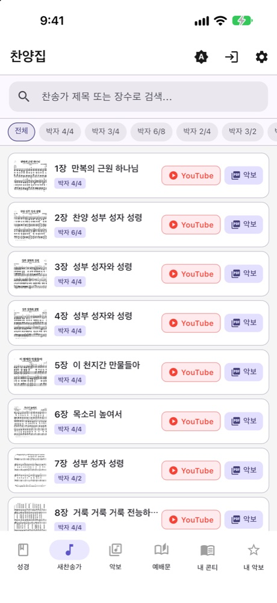
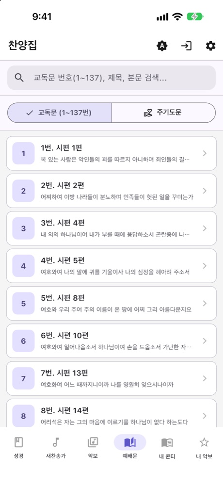

# churchpraise

교회 예배·찬양팀을 위한 새찬송가 & CCM 악보 뷰어 앱 (Flutter, Android / iOS).

자세한 소개는 [PORTFOLIO.md](PORTFOLIO.md)를 참고하세요.

- 포트폴리오 사이트: [herjy6372.github.io/portfolio](https://herjy6372.github.io/portfolio/)

## 스크린샷

| 성경 | 새찬송가 | 예배문 |
|:---:|:---:|:---:|
|  |  |  |

## 저장소에 포함되지 않은 파일

저작권 문제로 다음 콘텐츠는 이 저장소에 포함하지 않습니다.

- `assets/hymns_pdf/` — 새찬송가 악보 PDF
- `assets/bible/` — 성경 본문 데이터

빌드하려면 위 경로에 해당 파일을 직접 준비해야 합니다.

성경 역본 파일은 다음과 같습니다.

| 파일 | 역본 | 비고 |
|---|---|---|
| `assets/bible/ko_rev.json` | 개역개정 (기본) | 대한성서공회 저작권 |
| `assets/bible/ko_krv.json` | 개역한글 | [thiagobodruk/bible](https://github.com/thiagobodruk/bible)의 `ko_krv.json`을 변환 |
| `assets/bible/en_kjv.json` | KJV | 같은 저장소의 `en_kjv.json`을 변환 |

```bash
python3 tool/convert_bible.py <원본.json> assets/bible/ko_krv.json
```

릴리스 서명 파일(`android/key.properties`, `android/app/upload-keystore.jks`)도 포함되지 않습니다.

## 빌드

```bash
flutter pub get
flutter run
```
