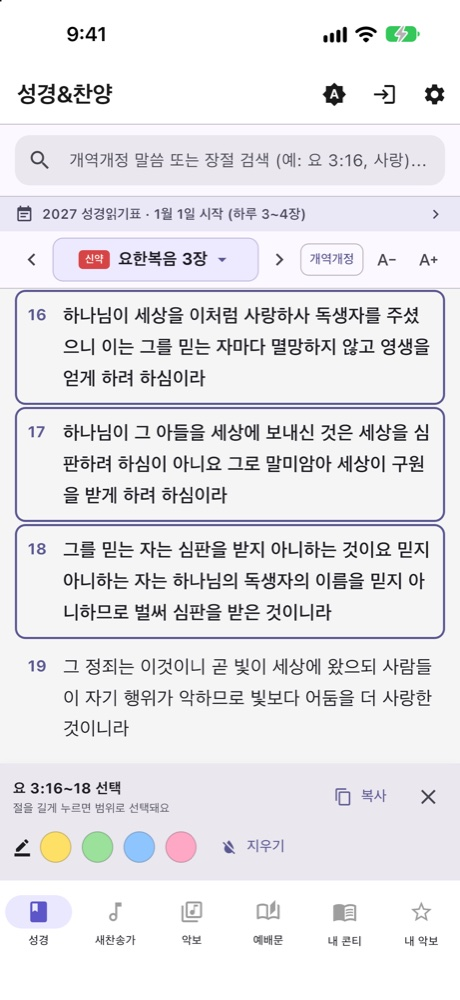

# churchpraise

**성경&찬양** — 교회 예배·찬양팀을 위한 성경 · 새찬송가 & CCM 악보 뷰어 앱 (Flutter, Android / iOS).

자세한 소개는 [PORTFOLIO.md](PORTFOLIO.md)를 참고하세요.

- 포트폴리오 사이트: [herjy6372.github.io/portfolio](https://herjy6372.github.io/portfolio/)

## 스크린샷

| 성경 비교 보기 · 형광펜 | 성경 선택 (구약) | 성경 선택 (신약) | 여러 절 선택 |
|:---:|:---:|:---:|:---:|
|  |  |  |  |
| **2027 성경읽기표** | **새찬송가** | **예배문** | |
|  |  |  | |

**태블릿 가로 · 비교 보기** (왼쪽 개역개정, 오른쪽 개역한글)


## Google Play 스토어 이미지

Play Console 스토어 등록정보에 올린 이미지는 [`docs/play-store/`](docs/play-store)에 보관합니다 (v1.5.0 기준).

| 폴더 | 파일 | 크기 | Play Console 항목 |
|---|---|---|---|
| [`graphics/`](docs/play-store/graphics) | `store_icon_512.png` | 512×512 | 앱 아이콘 |
| | `feature_graphic_1024x500.png` | 1024×500 | 그래픽 이미지 |
| [`phone/`](docs/play-store/phone) | `01_compare.jpg` ~ `06_liturgy.jpg` | 1080×1920 (9:16) | 휴대전화 스크린샷 |
| [`tablet/`](docs/play-store/tablet) | `tablet_01_compare.jpg` ~ `tablet_06_liturgy.jpg` | 1920×1080 (16:9) | 7인치·10인치 태블릿 스크린샷 |

스크린샷은 번호 순서(성경 비교 보기 → 색상 권 선택 → 여러 절 선택 → 2027 성경읽기표 → 새찬송가 → 예배문)대로 올립니다. 이미지를 바꿀 때는 이 폴더의 파일도 함께 교체하세요.

## 구조

```
lib/
├── main.dart                 앱 시작, Firebase 초기화
├── data/                     새찬송가 645곡·교독문·태그 정적 데이터
├── models/                   찬송가·악보·콘티 모델
├── screens/                  화면 (성경, 성경읽기표, 새찬송가·악보, 예배문, 콘티, 악보 뷰어, 설정)
├── services/                 성경 로드·검색, 형광펜, 2027 읽기표, 즐겨찾기, 콘티, 태그, 백업·복원
└── widgets/                  필터·태그 편집 시트
assets/
├── app_icon.png, app_icon_fg.png   앱 아이콘 원본 (flutter_launcher_icons)
├── bible/                    성경 역본 JSON (저장소에 없음)
└── hymns_pdf/                새찬송가 악보 PDF (저장소에 없음)
android/, ios/                플랫폼 설정 (Firebase 설정 포함, 서명 키 제외)
firestore.rules               Firestore 보안 규칙 (본인 users/{uid} 문서만 읽기·쓰기, 콘솔에 게시된 내용과 동일)
docs/
├── screenshots/              README·PORTFOLIO.md용 앱 스크린샷
└── play-store/               Google Play 스토어 이미지
    ├── graphics/             앱 아이콘 512×512, 그래픽 이미지 1024×500
    ├── phone/                휴대전화 스크린샷 1080×1920
    └── tablet/               7인치·10인치 태블릿 스크린샷 1920×1080
tool/convert_bible.py         성경 역본 원본 JSON → 앱 형식 변환
test/                         성경 역본별 검색, 읽기표, 형광펜 등 단위 테스트
church_website/               김천침례교회 홈페이지 (정적 HTML)
PORTFOLIO.md                  프로젝트 상세 소개·작업 과정
```

## 저장소에 포함되지 않은 파일

저작권 문제로 다음 콘텐츠는 이 저장소에 포함하지 않습니다.

- `assets/hymns_pdf/` — 새찬송가 악보 PDF
- `assets/bible/` — 성경 본문 데이터

빌드하려면 위 경로에 해당 파일을 직접 준비해야 합니다.

성경 역본 파일은 다음과 같습니다.

| 파일 | 역본 | 비고 |
|---|---|---|
| `assets/bible/ko_rev.json` | 개역개정 (기본) | 대한성서공회 저작권 |
| `assets/bible/ko_krv.json` | 개역한글 | [thiagobodruk/bible](https://github.com/thiagobodruk/bible)의 `ko_krv.json`을 변환 |
| `assets/bible/en_kjv.json` | KJV | 같은 저장소의 `en_kjv.json`을 변환 |

```bash
python3 tool/convert_bible.py <원본.json> assets/bible/ko_krv.json
```

릴리스 서명 파일(`android/key.properties`, `android/app/upload-keystore.jks`)도 포함되지 않습니다.

## 빌드

```bash
flutter pub get
flutter run
```
