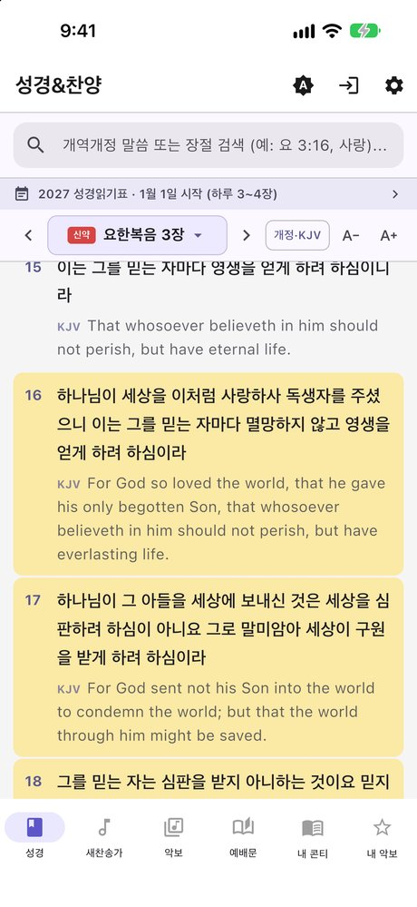
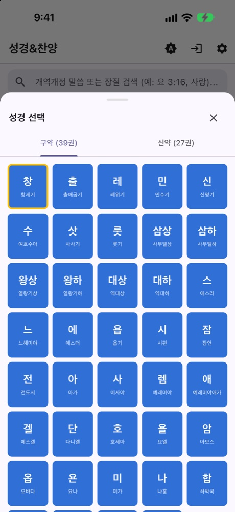
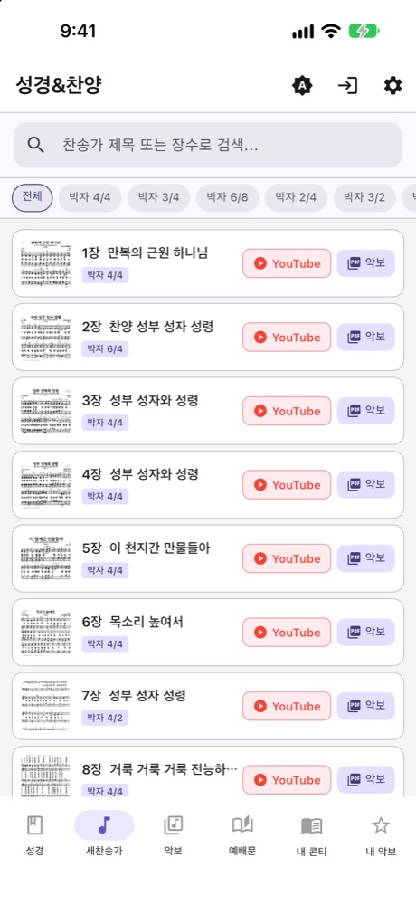
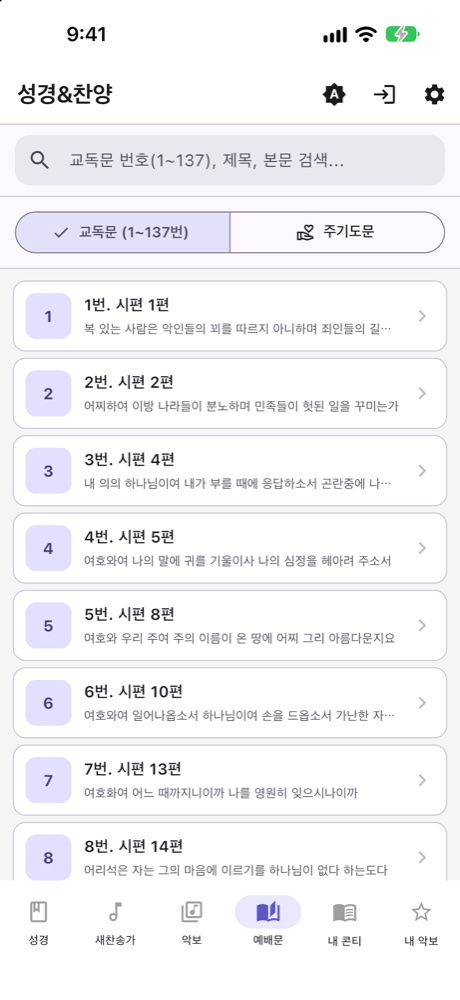
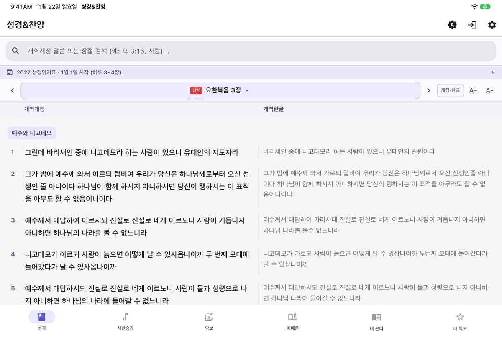

# churchpraise

**성경&찬양** — 교회 예배·찬양팀을 위한 성경 · 새찬송가 & CCM 악보 뷰어 앱 (Flutter, Android / iOS).

자세한 소개는 [PORTFOLIO.md](PORTFOLIO.md)를 참고하세요.

- 포트폴리오 사이트: [herjy6372.github.io/portfolio](https://herjy6372.github.io/portfolio/)

## 스크린샷

| 성경 비교 보기 · 형광펜 | 성경 선택 (구약) | 성경 선택 (신약) | 여러 절 선택 |
|:---:|:---:|:---:|:---:|
|  |  |  |  |
| **2027 성경읽기표** | **새찬송가** | **예배문** | |
|  |  |  | |

**태블릿 가로 · 비교 보기** (왼쪽 개역개정, 오른쪽 개역한글)



## Google Play 스토어 이미지

Play Console 스토어 등록정보에 올린 이미지는 [`docs/play-store/`](docs/play-store)에 보관합니다 (v1.5.0 기준).

| 폴더 | 파일 | 크기 | Play Console 항목 |
|---|---|---|---|
| [`graphics/`](docs/play-store/graphics) | `store_icon_512.png` | 512×512 | 앱 아이콘 |
| | `feature_graphic_1024x500.png` | 1024×500 | 그래픽 이미지 |
| [`phone/`](docs/play-store/phone) | `01_compare.jpg` ~ `06_liturgy.jpg` | 1080×1920 (9:16) | 휴대전화 스크린샷 |
| [`tablet/`](docs/play-store/tablet) | `tablet_01_compare.jpg` ~ `tablet_06_liturgy.jpg` | 1920×1080 (16:9) | 7인치·10인치 태블릿 스크린샷 |

스크린샷은 번호 순서(성경 비교 보기 → 색상 권 선택 → 여러 절 선택 → 2027 성경읽기표 → 새찬송가 → 예배문)대로 올립니다. 이미지를 바꿀 때는 이 폴더의 파일도 함께 교체하세요.

## 구조

```
lib/
├── main.dart                 앱 시작, Firebase 초기화
├── data/                     새찬송가 645곡·교독문·태그 정적 데이터
├── models/                   찬송가·악보·콘티 모델
├── screens/                  화면 (성경, 성경읽기표, 새찬송가·악보, 예배문, 콘티, 악보 뷰어, 설정)
├── services/                 성경 로드·검색, 형광펜, 2027 읽기표, 즐겨찾기, 콘티, 태그, 서버 백업·복원, 파일 백업(zip)
└── widgets/                  필터·태그 편집 시트
assets/
├── app_icon.png, app_icon_fg.png   앱 아이콘 원본 (flutter_launcher_icons)
├── bible/                    성경 역본 JSON (저장소에 없음)
└── hymns_pdf/                새찬송가 악보 PDF (저장소에 없음)
android/, ios/                플랫폼 설정 (Firebase 설정 포함, 서명 키 제외)
firestore.rules               Firestore 보안 규칙 (본인 users/{uid} 문서만 읽기·쓰기, 콘솔에 게시된 내용과 동일)
docs/
├── screenshots/              README·PORTFOLIO.md용 앱 스크린샷
└── play-store/               Google Play 스토어 이미지
    ├── graphics/             앱 아이콘 512×512, 그래픽 이미지 1024×500
    ├── phone/                휴대전화 스크린샷 1080×1920
    └── tablet/               7인치·10인치 태블릿 스크린샷 1920×1080
tool/convert_bible.py         성경 역본 원본 JSON → 앱 형식 변환
test/                         성경 역본별 검색, 읽기표, 형광펜, 파일 백업 등 단위 테스트
church_website/               김천침례교회 홈페이지 (정적 HTML)
PORTFOLIO.md                  프로젝트 상세 소개·작업 과정
```

## 저장소에 포함되지 않은 파일

저작권 문제로 다음 콘텐츠는 이 저장소에 포함하지 않습니다.

- `assets/hymns_pdf/` — 새찬송가 악보 PDF
- `assets/bible/` — 성경 본문 데이터

빌드하려면 위 경로에 해당 파일을 직접 준비해야 합니다.

성경 역본 파일은 다음과 같습니다.

| 파일 | 역본 | 비고 |
|---|---|---|
| `assets/bible/ko_rev.json` | 개역개정 (기본) | 대한성서공회 저작권 |
| `assets/bible/ko_krv.json` | 개역한글 | [thiagobodruk/bible](https://github.com/thiagobodruk/bible)의 `ko_krv.json`을 변환 |
| `assets/bible/en_kjv.json` | KJV | 같은 저장소의 `en_kjv.json`을 변환 |

```bash
python3 tool/convert_bible.py <원본.json> assets/bible/ko_krv.json
```

릴리스 서명 파일(`android/key.properties`, `android/app/upload-keystore.jks`)도 포함되지 않습니다.

## 백업과 복원

설정 화면에서 두 가지 방식으로 데이터를 옮길 수 있습니다.

| 방식 | 필요한 것 | 담기는 내용 | 저장 위치 |
|---|---|---|---|
| 서버 백업 (계정 및 동기화) | Google 로그인, 인터넷 | 즐겨찾기·콘티·태그·필기·형광펜·읽기표 진도 | Firestore `users/{uid}` 문서 (최대 1MB) |
| 파일로 백업 (v1.6.0~) | 없음 | 위 내용 + **내 악보 원본 파일(PDF·이미지)** | 사용자가 고른 위치 (iOS 파일 앱, Android 다운로드·드라이브 등) |

- 파일 백업은 `성경찬양_백업_날짜_시각.zip` 하나로 저장되며, 안에 `backup.json`(데이터와 내 악보 목록)과 `scores/`(악보 파일)가 들어 있습니다. 구현은 [`lib/services/local_backup_service.dart`](lib/services/local_backup_service.dart), 파일 저장·선택은 Android SAF와 iOS 문서 선택기를 MethodChannel로 연결했습니다.
- 파일에서 복원하면 데이터는 덮어쓰고, 내 악보는 기존 것을 그대로 두고 백업에만 있는 것을 더합니다.
- 다른 앱의 파일이나 손상된 파일은 거부하고, 앱이 쓰는 데이터 항목만 되살리며, 악보 파일은 앱이 정한 이름으로 악보 폴더 안에만 저장합니다. 데이터 형식이 맞지 않으면 원래 값으로 되돌립니다.

## 테스터 모집 (교회 홈페이지)

비공개 테스트 참여자는 김천침례교회 홈페이지의 신청 페이지(`app-beta.html`, 메인 배너에서 새 창으로 열림)로 모집합니다.

- 신청서로 Google 계정·이름·휴대폰 번호를 받아 Firestore `testerRequests`에 저장하고, 관리자가 Play Console 테스터 목록에 등록한 뒤 참여 안내 문자를 보냅니다.
- 앱 업데이트에 맞춰 신청 페이지의 기능 소개를 함께 갱신합니다.
  - 2026.11.22 (v1.5.0) — "두 역본 비교 보기" 항목과 비교 보기 화면 스크린샷 추가
  - 2026.11.28 (v1.6.0) — "파일로 백업 — 로그인 없이 내 악보까지 기기에 저장" 항목 추가
- 2026.11.28 보안 점검에서 신청 데이터는 누구나 형식에 맞는 생성만, 열람·처리·삭제는 관리자만 가능하도록 규칙을 확인하고, 함께 발견한 홈페이지 문제(승인 전 회원의 게시판 열람, 구글 첫 가입 실패, 성별·휴대폰 변경)를 수정했습니다.
- 이 저장소의 `church_website/`는 초기 정적 버전이며, 현재 홈페이지(회원 시스템·신청 페이지 포함)는 별도 저장소에서 관리합니다.

## 보안

- **백업 데이터**: Google 로그인 후 Firestore `users/{uid}` 문서 하나에 즐겨찾기·콘티·태그·필기·형광펜·읽기표 진도를 저장합니다. [`firestore.rules`](firestore.rules)는 로그인한 본인만 자기 문서를 읽고 쓸 수 있게 하고, 그 밖의 경로는 모두 거부합니다. 규칙을 바꾸면 Firebase 콘솔(Firestore Database → 규칙)에 게시해야 적용됩니다.
- **Firebase 설정 파일**: `google-services.json`, `GoogleService-Info.plist`, `lib/firebase_options.dart`의 API 키는 앱에 포함되는 식별용 값이라 공개되어도 되며, 데이터 보호는 보안 규칙이 담당합니다.
- **서명 키**: 릴리스 서명 파일은 `.gitignore`로 제외합니다.

### 점검 기록
- 2026.11.28 — `flutter analyze` 문제 0건, 단위 테스트 20개 통과. 커밋 기록 전체에서 비밀번호·개인키·토큰이 올라간 적이 없음을 확인. Firestore 규칙을 Firebase 에뮬레이터에서 6가지 경우(본인 문서 읽기·쓰기 허용, 남의 문서 읽기·쓰기·비로그인 읽기·다른 경로 쓰기 거부)로 시험해 통과하고, 콘솔에만 있던 규칙을 `firestore.rules`로 저장소에 추가

## 빌드

```bash
flutter pub get
flutter run
```
